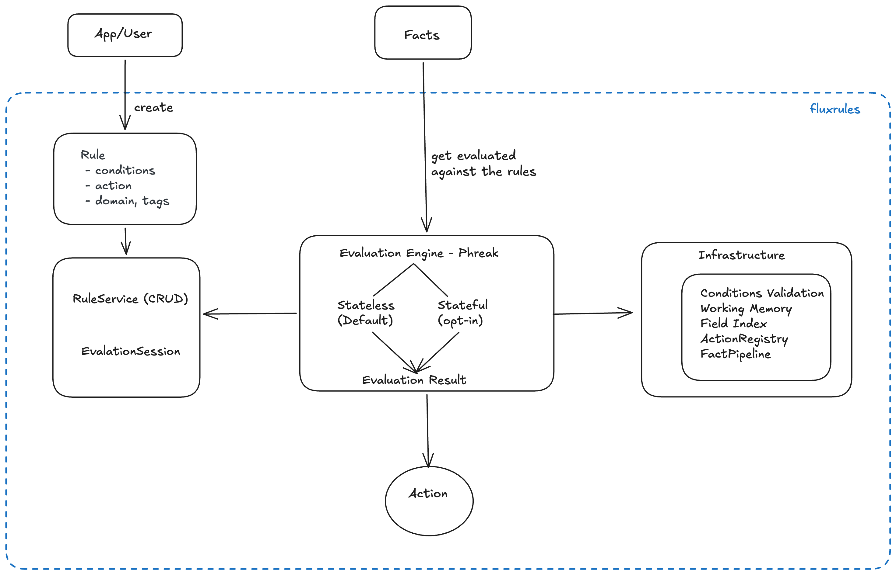

# Architecture

**Prerequisites:** [Concepts](concepts.md).

---

FluxRules is a lightweight rule evaluation engine with a clean layered architecture. This page describes the system design from the condition tree down to engine execution.

## System Architecture



---

## Evaluation Flow: From Fact to Result

For the full path a fact takes, including the fact pipeline, typed-fact
validation, discovery and action dispatch, see
[From Fact to Action](fact-to-action.md). The sketches below show the two call
shapes.

### Single Fact Evaluation (Simple API)

```
User: engine.evaluate({"amount": 5000, "country": "NG"})
  │
  ├─→ [1. Validate fact structure]
  │
  ├─→ [2. Iterate loaded rules]
  │    (via the PHREAK network)
  │
  ├─→ [3. For each rule:
  │       - Evaluate conditions against fact
  │       - If matched: add to fired_rules list
  │       - If matched: collect its action names (not executed)
  │
  ├─→ [4. Collect results]
  │    - fired_rules: List[int] (matched rule IDs)
  │    - actions: list[str] (action names, priority order)
  │    - latency_ms: float (execution time)
  │
  └─→ EvaluationResult(fired_rules=[1, 3], actions=["flag"], latency_ms=0.45)
```

### Multi-Step Workflow (Session-Based)

```
User: session = service.create_session()
  │
  ├─→ [1. Add facts incrementally]
  │    session.add_fact("user_type", "premium")
  │    session.add_fact("amount", 10000)
  │
  ├─→ [2. Evaluate against accumulated facts]
  │    result = session.evaluate()
  │
  ├─→ [3. Session remembers state (optional)]
  │    - Save snapshot for recovery
  │    - Restore in another process
  │
  └─→ EvaluationResult (same structure as simple API)
```

---

## The Engine: PHREAK

Every evaluation runs on one engine, `PhreakEngine`. It works in one of two
modes. In **stateless mode** (the default) each call is independent and
returns the full set of fired rules. In **streaming mode** the engine keeps
working memory between calls and reports only what changed.

[The PHREAK Engine](engine-comparison.md) explains both modes, and
[Choosing an Evaluation Mode](choosing-an-engine.md) helps you pick one.

---

## Condition Processing Pipeline

The conditions is a recursive JSON structure that's validated, compiled, and executed:

```
Input condition (F DSL or dict):
(F("amount") > 5000) & (F("country").isin(["NG", "US"]))

Compiled condition tree:
{
  "type": "group",
  "op": "AND",
  "children": [
    {"type": "condition", "field": "amount", "op": ">", "value": 5000},
    {"type": "condition", "field": "country", "op": "in", "value": ["NG", "US"]}
  ]
}
  │
  ├─→ [1. Parse & Validate]
  │    - Check syntax (type, op, field names)
  │    - Ensure operator is valid (==, !=, <, >, in, contains, etc.)
  │
  ├─→ [2. Convert to AST]
  │    - Build tree of condition nodes
  │    - Resolve operator functions
  │
  ├─→ [3. Evaluate against fact]
  │    - Traverse AST
  │    - Apply operators to fact values
  │    - Short-circuit AND/OR when possible
  │
  └─→ boolean result (True = rule fires)
```

---

## Data Model: Rule

```python
# python skip
Rule(
    name="high_value_payment",           # Identifier
    domain="fraud_detection",             # Grouping
    tags=frozenset(["tier_1", "urgent"]), # Cross-cutting labels
    priority=10,                          # Execution order (higher first)
    conditions={...},                  # The condition tree above
    action="flag_for_review",             # Action name
    persist=False                         # Optional: store in database
)
```

**Key design:**

- Rule is immutable once created (frozen Pydantic model)
- Conditions are pure predicates (no side effects)
- Actions are names; your application decides what each name does
- Domain/tags allow flexible rule organization

---

## Pluggability Points

You can replace three parts with your own code:

- **Engines**: subclass `BaseEngine` to change how matched rules are chosen.
  See [Custom Engines](custom-engines.md).
- **Actions**: register a handler for each action name. See
  [Actions](custom-actions.md).
- **Transforms**: add your own steps to a fact pipeline. See
  [Custom Transforms](custom-transforms.md).

[Extension Points](extension-points.md) lists every extension point and its
stability promise.

---

## Deployment Layers

### Standalone (Single Process)
```
┌──────────────────────┐
│  Your Application    │
│  ├─ PhreakEngine     │
│  └─ Rules            │
└──────────────────────┘
```

### Service-Based (HTTP)
```
┌──────────────────────┐
│  HTTP Client         │
│  └─ POST /evaluate   │
└──────────┬───────────┘
           │
┌──────────▼───────────┐
│  FastAPI Server      │
│  ├─ RuleService      │
│  ├─ PhreakEngine     │
│  └─ Rules (database) │
└──────────────────────┘
```

### Distributed (Microservices)
```
┌──────────────────────┐     ┌──────────────────────┐
│  Rule Editor         │────▶│  Rule Repository     │
└──────────────────────┘     └──────────┬───────────┘
                                        │
                    ┌───────────────────┼───────────────────┐
                    │                   │                   │
            ┌───────▼───────┐  ┌────────▼───────┐  ┌────────▼───────┐
            │  Engine Pod 1  │  │  Engine Pod 2  │  │  Engine Pod 3  │
            │  PhreakEngine  │  │  PhreakEngine  │  │  PhreakEngine  │
            │  (cached rules)│  │  (cached rules)│  │  (cached rules)│
            └────────────────┘  └────────────────┘  └────────────────┘
```

---

## Design Principles

1. **Evidence-first**: All documentation backed by working code
2. **Pydantic v2**: Rule validation via Pydantic (not home-grown)
3. **Pluggable**: Custom engines, actions, transforms via simple interfaces
4. **Fast**: Production-grade performance (ms-level latency)
5. **Simple**: Minimal API surface, small learning curve
6. **Lazy by default**: PHREAK's on-demand evaluation minimizes overhead

