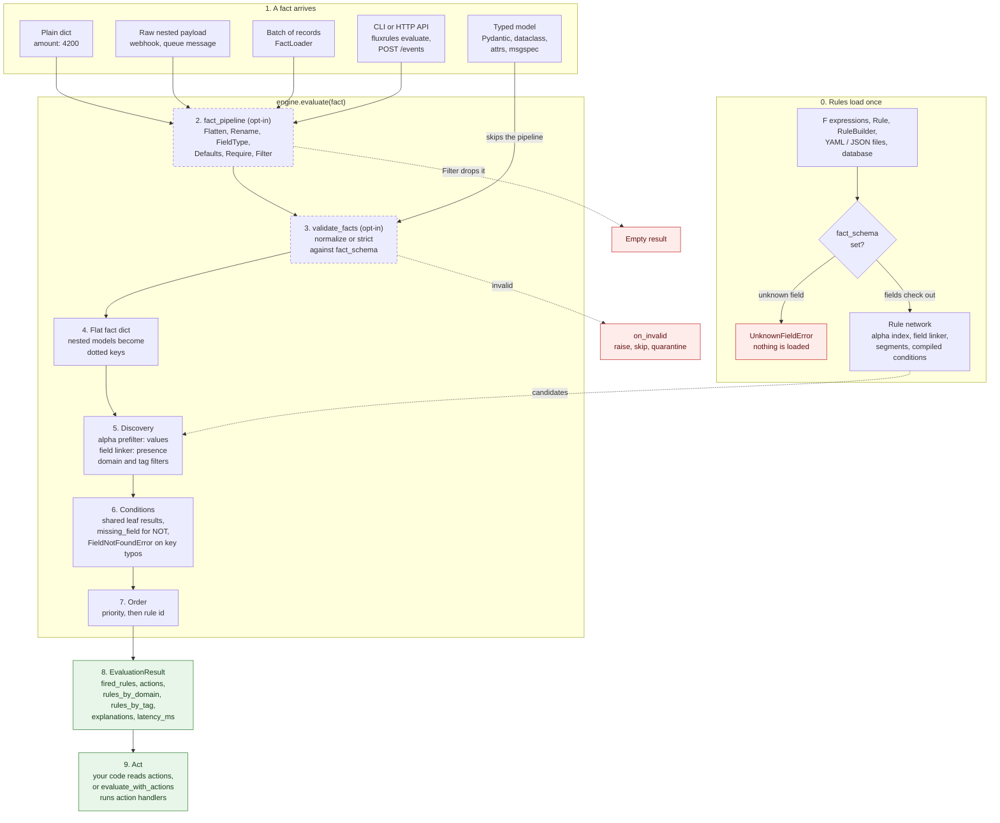

# From Fact to Action

**Prerequisites:** [Concepts](concepts.md).

---

A fact can reach `PhreakEngine` in several shapes: a plain dict, a raw nested
payload, a typed model, a batch of records, or a file passed to the CLI. This
page follows one fact from arrival to the actions it produces, and names the
feature that acts at each stage. Every stage marked *opt-in* costs nothing
until you turn it on.

## The flow



## Stage by stage

| Stage | What happens | Turn it on | Read more |
|---|---|---|---|
| 0. Rules load | Rules from any source become one `Rule` type. With a schema, every field each rule names is checked against the model, and a bad rule is refused before anything loads. The engine then builds its indexes once. | `PhreakEngine(fact_schema=Model)`; `fluxrules validate --schema` in CI | [Authoring Rules](authoring-rules.md), [YAML Rules](yaml-rules.md), [Typed Facts](typed-facts.md#check-rules-against-a-schema), [CLI](cli.md) |
| 1. Arrival | `evaluate()` takes a dict, any mapping, or a model instance. `FactLoader` reads batches; the CLI and HTTP API pass a parsed JSON dict. | Always on | [Concepts](concepts.md#fact), [Fact Pipeline](fact-pipeline.md#using-pipelines-with-engines), [REST API](rest-api.md) |
| 2. Pipeline | Raw input is reshaped: flatten, rename, coerce, fill defaults, require fields, filter. A filtered fact returns an empty result. A model instance skips this stage. | `fact_pipeline=FactPipeline([...])` | [Fact Pipeline](fact-pipeline.md) |
| 3. Validation | The fact is validated against the model: `userAge` and `user-age` become `user_age`, `"42"` becomes `42` (in `normalize`). An invalid fact is raised, skipped or quarantined. | `validate_facts="normalize"` or `"strict"`, `on_invalid=` | [Typed Facts](typed-facts.md#normalize-incoming-keys) |
| 4. Flat dict | Rules read flat keys, so nested models become dotted keys (`account.age_days`). | Always on | [Nested Facts](nested-facts.md) |
| 5. Discovery | Only rules that can match are kept: the alpha index drops rules whose values provably fail, the linker drops rules whose fields are absent, and optional domain or tag filters narrow further. In streaming mode only changed fields are re-linked. | Always on; `evaluate_by_domain`, `evaluate_by_tags`; `streaming_mode=True` | [Architecture](architecture.md), [Domains and Tags](domains-and-tags.md), [Choosing an Evaluation Mode](choosing-an-engine.md) |
| 6. Conditions | Surviving rules are evaluated. Identical sub-conditions are computed once per call. A rule naming `userAge` against a fact with `user_age` raises `FieldNotFoundError` instead of silently not matching. With `missing_field="unknown"`, a `NOT` rule does not fire just because the fact lacks the field. | Always on; `compile_conditions=True`; `EngineConfig(missing_field=...)` | [Conditions](conditions.md#missing-fields-and-not), [Complex Conditions](complex-conditions.md) |
| 7. Order | Fired rules are ordered by `priority`, highest first, then by rule id. | `Rule(priority=...)` | [Rule Types](rule-types.md) |
| 8. Result | One `EvaluationResult` for every path: which rules fired, their actions in order, grouping by domain and tag, an explanation per rule, and latency. | Always on; `enable_metrics=True` for percentiles | [Concepts](concepts.md#evaluation-result), [Observability](observability.md) |
| 9. Act | `evaluate()` never runs side effects: it returns action names. Your code dispatches them, or `await engine.evaluate_with_actions(fact)` runs the registered handlers. | `@action` handlers | [Custom Actions](custom-actions.md), [Action Registry](action-registry.md) |

Rules that join several facts (an order and its customer) take a different
engine, `CrossFactEngine`, with its own insert and retract contract. See
[Cross-Fact Rules](cross-fact-rules.md).

## One fact, end to end

A payment model, three rules in two domains, and an engine with the opt-in
fact stages switched on. The rules use `fields(Payment)`, which names fields
through the model; see
[Conditions](conditions.md#4-checked-field-references-with-fieldsmodel).

```python
from pydantic import BaseModel, ConfigDict

from fluxrules import Rule
from fluxrules.engine.phreak import PhreakEngine
from fluxrules.facts import fields, lenient_aliases
from fluxrules.pipeline import Defaults, FactPipeline


class Account(BaseModel):
    model_config = ConfigDict(alias_generator=lenient_aliases())

    age_days: int
    country: str


class Payment(BaseModel):
    model_config = ConfigDict(alias_generator=lenient_aliases())

    amount: float
    channel: str
    account: Account


p = fields(Payment)  # checked field references: a typo fails here
rules = [
    Rule(
        id=1,
        name="block_high_risk_country",
        priority=100,
        domain="fraud",
        conditions=p.account.country.isin(["NG", "RU"]) & (p.amount > 1000),
        action="block",
    ),
    Rule(
        id=2,
        name="review_new_account",
        priority=50,
        domain="fraud",
        conditions=(p.amount > 2000) & (p.account.age_days < 14),
        action="manual_review",
    ),
    Rule(
        id=3,
        name="tag_api_traffic",
        priority=10,
        domain="ops",
        conditions=p.channel == "api",
        action="tag_api",
    ),
]

engine = PhreakEngine(
    fact_schema=Payment,
    validate_facts="normalize",
    on_invalid="quarantine",
    fact_pipeline=FactPipeline([Defaults({"channel": "web"})]),
)
engine.load_rules(rules)
```

What each option does here:

| Option | Stage | Meaning |
|---|---|---|
| `fact_schema=Payment` | 0 | `load_rules` checks every field the rules name against `Payment`. A rule that names a field `Payment` does not have is refused. |
| `fact_pipeline=...` | 2 | Before anything else, each incoming dict passes through the pipeline. Here `Defaults` adds `channel: "web"` when the fact has no `channel`. |
| `validate_facts="normalize"` | 3 | Each fact is checked against `Payment` and cleaned up: `Amount` and `ageDays` are renamed to `amount` and `age_days` (the models use `lenient_aliases()`), and `"4200"` becomes `4200.0`. |
| `on_invalid="quarantine"` | 3 | Decides what happens to a fact that fails that check, such as an amount of `"lots"`. The engine does not raise an error. It returns an empty result and keeps the fact, with the reason it failed, in `engine.quarantined_facts`, so you can inspect or replay it later. The other choices are `"raise"` (the default) and `"skip"`, which logs a warning and drops the fact. |

One more option belongs to stage 6 but is not needed here, because none of
these rules use `NOT`: `EngineConfig(missing_field="unknown")`. A condition on
a field the fact does not have is false, so a rule such as "not blocked"
(`~(F("blocked") == True)`) fires even when the fact has no `blocked` field at
all. With `missing_field="unknown"` the engine treats the missing field as
unknown and the rule does not fire. See
[Missing fields and NOT](conditions.md#missing-fields-and-not).

A raw webhook payload, with camelCase keys, numbers as strings, nesting, and no
`channel`, takes every stage:

```python
webhook = {"Amount": "4200", "account": {"ageDays": "3", "country": "NG"}}

result = engine.evaluate(webhook)
assert result.fired_rules == [1, 2]  # priority 100 before 50
assert result.actions == ["block", "manual_review"]
assert result.rules_by_domain == {"fraud": [1, 2]}
```

A model instance is already structured, so it skips the pipeline and is not
re-validated:

```python
order = Payment(amount=50, channel="api", account=Account(age_days=400, country="US"))
assert engine.evaluate(order).actions == ["tag_api"]
```

Discovery can be narrowed to the rules of one domain:

```python
assert engine.evaluate_by_domain(webhook, ["ops"]).fired_rules == []
```

A fact that fails validation is quarantined instead of raised. The stored fact
already has `channel`, because the pipeline ran before validation:

```python
assert engine.evaluate({"amount": "lots"}).fired_rules == []

[rejected] = engine.quarantined_facts
assert rejected.facts == {"amount": "lots", "channel": "web"}
print(rejected.error)  # what failed: amount is not a number, account is missing
```

The same rules can live in a YAML file that names `fact_schema`, and
`fluxrules validate rules.yaml` checks them in CI before any of this runs. See
[CLI](cli.md).

## Next Steps

- [Typed Facts](typed-facts.md) - schemas, validation and checked field references
- [Fact Pipeline](fact-pipeline.md) - transforms for raw input
- [CLI](cli.md) - validate and evaluate rule files from the command line
- [Architecture](architecture.md) - how the rule network is built
- [Example 31: Typed Facts](https://github.com/saurabh2mishra/fluxrules/blob/main/examples/31_typed_facts.py) - the same ideas as a runnable script
